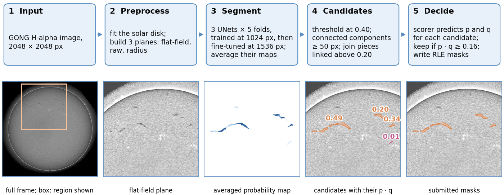
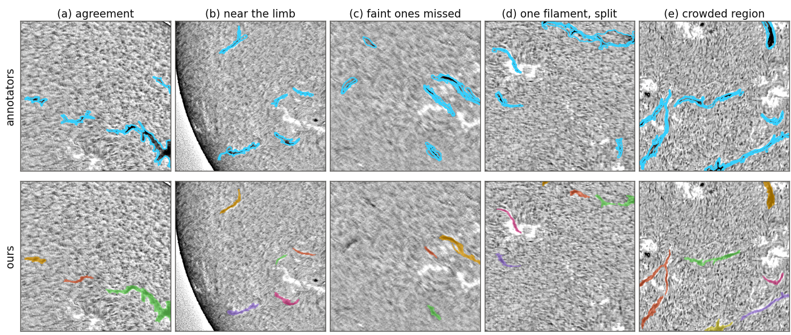
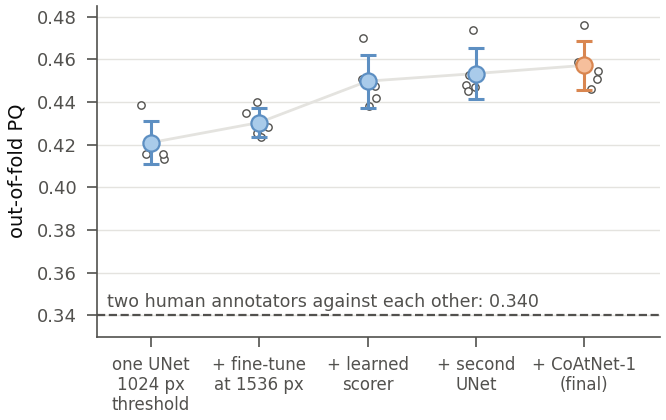
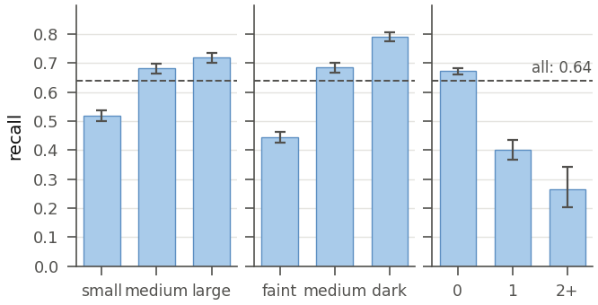

# Three UNets and a learned instance scorer

**A solution to the [Solar Filament Segmentation Challenge 2026](https://www.kaggle.com/competitions/filament-segmentation-2026)**:
one mask per solar filament in GONG H-alpha full-disk images.



| | |
|---|---|
| Out-of-fold Panoptic Quality (707 training images) | **0.457** (95% interval 0.448 to 0.465) |
| Two human annotators against each other | 0.34 |
| Public leaderboard | 0.39 |
| Submitted file | [`submissions/v2_blend_r2_exp8_coat1_pq0.16.csv`](submissions/v2_blend_r2_exp8_coat1_pq0.16.csv) |

Everything needed to reproduce the submitted file is in this repository: the code, a pinned
[`requirements.txt`](requirements.txt), one [notebook](notebooks/pipeline.ipynb) that runs the
whole pipeline, and the trained weights. No model has to be retrained.

## How it works

1. **Preprocess.** Fit the solar disk, then build three input planes: the image divided by its
   own illumination (which removes limb darkening), the raw image, and the normalised radius.
2. **Segment.** Three UNets predict a filament probability map: two on a ConvNeXt-V2-tiny
   encoder and one on CoAtNet-1. Each is trained at 1024 px, then fine-tuned at 1536 px
   (1280 px for CoAtNet-1), once per cross-validation fold. Their maps are averaged.
3. **Cut candidates.** Threshold the averaged map at 0.40. Each connected region of at least
   50 px is a candidate filament; regions linked above 0.20 are joined.
4. **Score.** Two LightGBM models predict, for each candidate, `p` (the probability that an
   annotator drew it) and `q` (how well the two would overlap).
5. **Decide.** Keep a candidate when `p · q ≥ 0.16`, the cut that maximises Panoptic Quality on
   held-out data, and write each kept mask as an RLE string.



The scorer is the largest single step. Annotators disagree on which filaments to draw, so a
fixed threshold keeps many regions that nobody annotated:

<p align="center"></p>

## Reproduce the submission

**1. Install.** Python 3.11.

```bash
git clone https://github.com/Smooth-Cactus0/solar-filament-segmentation-2026.git
cd solar-filament-segmentation-2026
pip install -r requirements.txt
```

For a GPU, install the matching PyTorch build first, for example
`pip install torch==2.6.0 torchvision==0.21.0 --index-url https://download.pytorch.org/whl/cu124`.

**2. Get the test images.** Download the competition data and unzip it at the repository root,
so that `filament-segmentation-2026/MAGFiLO_1.0_Kaggle_2026/test/` exists. To keep the data
elsewhere, set the environment variable `FILSEG_DATA_ROOT` to the `MAGFiLO_1.0_Kaggle_2026`
folder.

**3. Run the notebook.** Open [`notebooks/pipeline.ipynb`](notebooks/pipeline.ipynb) and run all
cells, or run the same cells without Jupyter:

```bash
PYTHONPATH=src python scripts/run_notebook.py notebooks/pipeline.ipynb
```

The notebook:

- joins the weight files and checks them against `weights/SHA256SUMS` (see [Weights](#weights));
- computes the probability maps of the three UNets on the 180 test images;
- averages them, cuts and scores the candidates, and writes the submission CSV to
  `pipeline_out/submissions/`;
- checks the file against the competition's format rules and compares it with the submitted
  file in `submissions/`.

| Setting | Effect |
|---|---|
| `--set LIMIT=3` | a quick run on the first three test images |
| `--set DEVICE=cpu` | run without a GPU (slow: 60 forward passes per image) |
| `--set FROM_MAPS=True` | skip inference and reuse maps already in `pipeline_out/cache` |

On one 48 GB GPU the full run takes about a quarter of an hour. The steps after inference need
no GPU and take about two minutes.

A note on exactness: from the same probability maps, the notebook reproduces the submitted
file byte for byte. When the maps are recomputed on a different GPU, floating-point rounding
can move a probability by one level out of 255 at a few pixels, and the notebook then reports
any image whose masks differ.

## Weights

The trained weights are in [`weights/`](weights/):

- 15 UNet checkpoints, `<family>_fold<k>.pt` for three families and five folds;
- the scorer: ten LightGBM models and a feature list in `weights/scorer/`.

GitHub refuses files above 100 MB, and a checkpoint is 128 to 181 MB. Each checkpoint is
therefore stored as two parts (`.part0`, `.part1`), which are plain byte slices of the file.
The notebook joins them on its first run. To do it by hand:

```bash
PYTHONPATH=src python -c "from filseg import weights; weights.assemble('weights')"
```

## Repository layout

```
notebooks/pipeline.ipynb    the whole pipeline, from test images to the submission file
src/filseg/                 the library: data, preprocessing, model, metric, candidates, scorer
scripts/                    one command-line script per pipeline stage
configs/                    training configurations of the three UNet families
weights/                    trained UNet checkpoints (in parts) and scorer models
submissions/                the submitted file, for comparison
data/folds.csv              the five cross-validation folds
tests/                      unit tests on synthetic data (python -m pytest tests -q)
docs/figures/               the figures of this page
```

## Train from scratch

Reproducing the submission does not need this section. It shows how the weights were made.

```bash
# 1. Folds: five folds grouped by image, balanced by filament count and solar-cycle period
PYTHONPATH=src python scripts/make_folds.py

# 2. UNets: for every fold k in 0..4, stage 1 at 1024 px, then stage 2 from its checkpoint
PYTHONPATH=src python scripts/train.py --config configs/scr_r2_base_1024.yaml --fold $k
PYTHONPATH=src python scripts/train.py --config configs/scr_r2_base_1536.yaml --fold $k \
    --init-from checkpoints/scr_r2_base_1024_fold$k.pt
PYTHONPATH=src python scripts/train.py --config configs/exp8a_convnextv2_1024.yaml --fold $k
PYTHONPATH=src python scripts/train.py --config configs/exp8b_convnextv2_1536.yaml --fold $k \
    --init-from checkpoints/exp8a_convnextv2_1024_fold$k.pt
PYTHONPATH=src python scripts/train.py --config configs/scr_r2_coatnet1_1024.yaml --fold $k
PYTHONPATH=src python scripts/train.py --config configs/scr_r2_coatnet1_1280.yaml --fold $k \
    --init-from checkpoints/scr_r2_coatnet1_1024_fold$k.pt

# 3. Probability maps: held-out maps for the training images, fold-ensemble maps for the test images
for m in scr_r2_base_1536 exp8b_convnextv2_1536 scr_r2_coatnet1_1280; do
  PYTHONPATH=src python scripts/cache_probs.py --config configs/$m.yaml \
      --checkpoints checkpoints/${m}_fold{0,1,2,3,4}.pt --folds-csv data/folds.csv --outdir cache/$m
done

# 4. Average the three families
PYTHONPATH=src python scripts/blend_caches.py \
    --caches cache/scr_r2_base_1536 cache/exp8b_convnextv2_1536 cache/scr_r2_coatnet1_1280 \
    --out cache/blend_r2_exp8_coat1

# 5. Candidates of the held-out maps, one row per candidate and annotation pass
PYTHONPATH=src python scripts/build_scorer_table.py --cache cache/blend_r2_exp8_coat1 \
    --threshold 0.40 --min-area 50 --bridge 0.20 \
    --out data/scorer/blend_r2_exp8_coat1_thr0.40_ma50_bridge0.20.csv.gz

# 6. Scorer: held-out p and q for every candidate, and the best cut on p · q
PYTHONPATH=src python scripts/train_scorer.py \
    --table data/scorer/blend_r2_exp8_coat1_thr0.40_ma50_bridge0.20.csv.gz \
    --version scorer_v2_blend_r2_exp8_coat1

# 7. Submission from the test maps
PYTHONPATH=src python scripts/submission_from_cache.py --cache cache/blend_r2_exp8_coat1 \
    --threshold 0.40 --min-area 50 --candidate-bridge 0.20 \
    --scorer-dir checkpoints/scorer --scorer-version scorer_v2_blend_r2_exp8_coat1 \
    --accept-pq 0.16 --out submissions/v2_blend_r2_exp8_coat1_pq0.16.csv
```

Training the three families took 85 GPU hours: the two ConvNeXt-V2 families on a 10 GB
RTX 3080, CoAtNet-1 on a 48 GB RTX A6000. Steps 4 to 7 run on a CPU.

## Where it is weak

Recall is lowest on faint, small and crowded filaments:

<p align="center"></p>

From left to right: recall by size, by contrast (both split into thirds) and by the number of
other filaments within 100 px, with 95% intervals. The dashed line is the overall recall, 0.64.

## Data use

- Training, validation and model selection used only the competition's training images and
  annotations.
- The test images were used for inference only. Their annotations are part of the public
  MAGFiLO release; they were not used.
- The encoders start from public ImageNet-pretrained weights.

## Licences

- **Code:** MIT, see [`LICENSE`](LICENSE).
- **Trained weights:** CC-BY-NC-4.0. They inherit the non-commercial licence of the
  ConvNeXt-V2 ImageNet weights they start from; the CoAtNet-1 ImageNet weights are Apache-2.0.
- **Data:** the competition data is not redistributed here.

## Acknowledgment

This work uses GONG data from the NSO Integrated Synoptic Program, and the MAGFiLO annotations
(Ahmadzadeh et al., *Scientific Data* 11, 1031, 2024) as released for the challenge.
